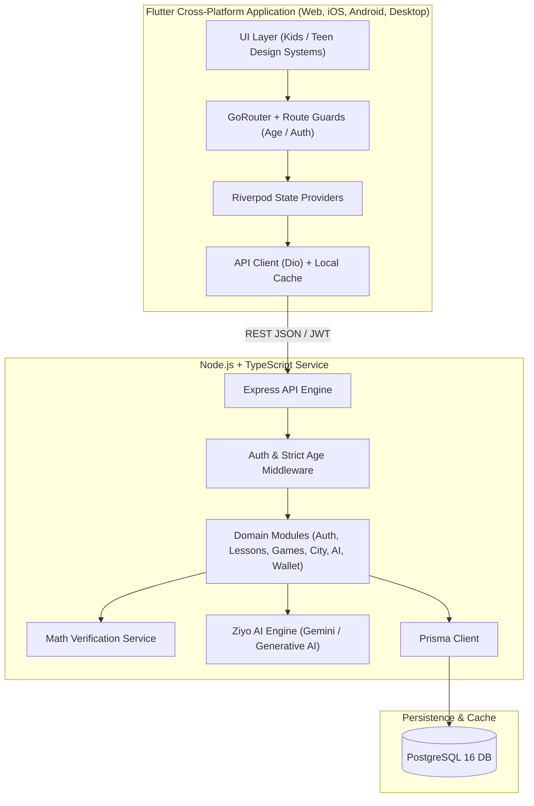

# MathCity AI — Full-Stack Architecture Documentation

## 1. High-Level System Architecture



## 2. Age Eligibility System Rules

- **Age 6–12**: Assigned to `KIDS` mode automatically.
- **Age 13–16**: Assigned to `TEEN` mode automatically.
- **Age 17+**: **STRICTLY DENIED** access to student features. Server and router reject access with `403 ELIGIBILITY_FAILED` and redirect to `/access-denied`.
- **Under 6**: Blocked as unsupported.
- **Age Computation Algorithm**:
  Calculated strictly server-side from `dateOfBirth` using UTC year/month/day comparison, accounting for leap years and exact birthday timestamps:
  ```ts
  const today = new Date();
  let age = today.getFullYear() - dob.getFullYear();
  const m = today.getMonth() - dob.getMonth();
  if (m < 0 || (m === 0 && today.getDate() < dob.getDate())) {
    age--;
  }
  ```

## 3. Database Schema Entities (Prisma)

- `User`: Base credentials (email, hashed password, role, status).
- `StudentProfile`: Name, date of birth, age, grade (1-11), mode (`KIDS` | `TEEN`), avatar.
- `CoinWallet`: User ID, balance (integer, non-negative constraint).
- `CoinTransaction`: Amount, type (`LESSON_COMPLETE`, `EXERCISE_CORRECT`, `GAME_WIN`, `BUILDING_PURCHASE`), timestamp, idempotency key.
- `StudentXP`: Total XP, current level.
- `Course`: Grade, subject, title, description, order.
- `Lesson`: Course ID, title, overview, content markdown, order, required XP.
- `Question`: Lesson ID, question text, type (`MULTIPLE_CHOICE`, `FRACTION_MATCH`, `EQUATION_SOLVE`), options JSON, correct answer, explanation, hint.
- `ExerciseAttempt`: User ID, Question ID, submitted answer, isCorrect, timestamp.
- `LessonProgress`: User ID, Lesson ID, completed status, score, completedAt.
- `BuildingDefinition`: Key, name, costInCoins, requiredLevel, type, assetPath.
- `OwnedBuilding`: User ID, BuildingDefinition Key, gridX, gridY, placedAt.
- `GameSession`: User ID, gameType, score, coinsEarned, xpEarned, durationSeconds.
- `DailyTask`: Title, description, targetCount, rewardCoins, rewardXP.
- `StudentDailyTask`: User ID, Task ID, currentCount, isCompleted, claimedAt.
- `Achievement`: Key, title, description, iconPath, rewardCoins, rewardXP.
- `StudentAchievement`: User ID, Achievement Key, unlockedAt.
- `AIMessage`: User ID, role (`USER` | `ASSISTANT`), text, formulaLatex, createdAt.

## 4. Financial & Reward Integrity (Gold Coins & XP)

- **Zero-Trust Client**: Client can never self-credit coins or XP.
- **Transactional Atomicity**: All coin debits (e.g. buying a building) and credits (e.g. completing a lesson) occur inside Prisma `$transaction` blocks.
- **Non-Negative Balance**:
  ```ts
  if (wallet.balance < building.costInCoins) {
    throw new BadRequestError("Yetarli oltin tanga mavjud emas");
  }
  ```
- **Currency Distinction**:
  - **Oltin tanga (Gold Coins)**: Liquid in-game currency spent in the building shop (`Qurilish do'koni`).
  - **XP**: Progression metric indicating mastery, cannot be spent.
  - **No Stars**: Golden-yellow coins are the only currency.
